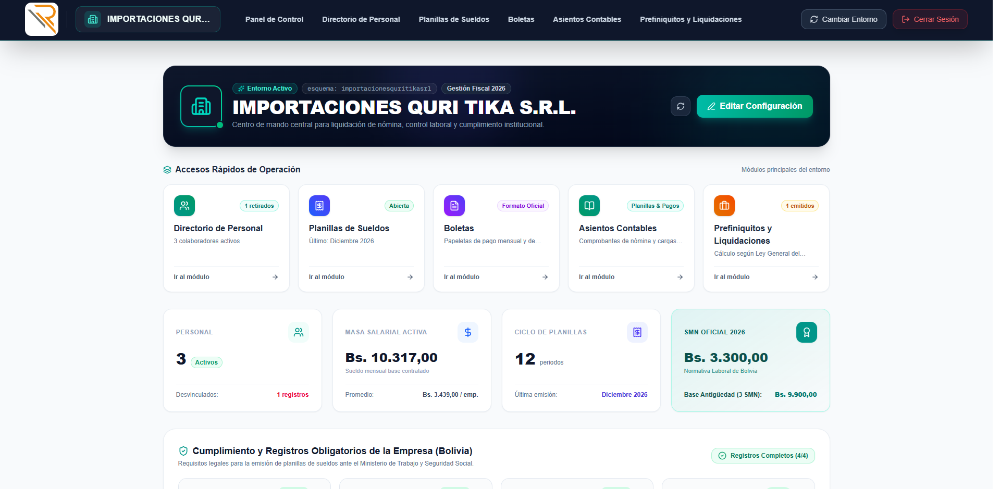
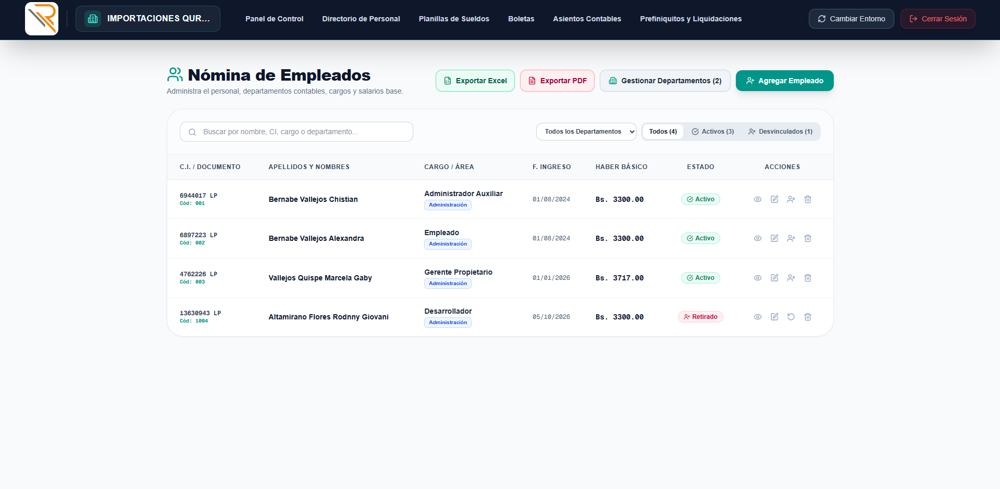
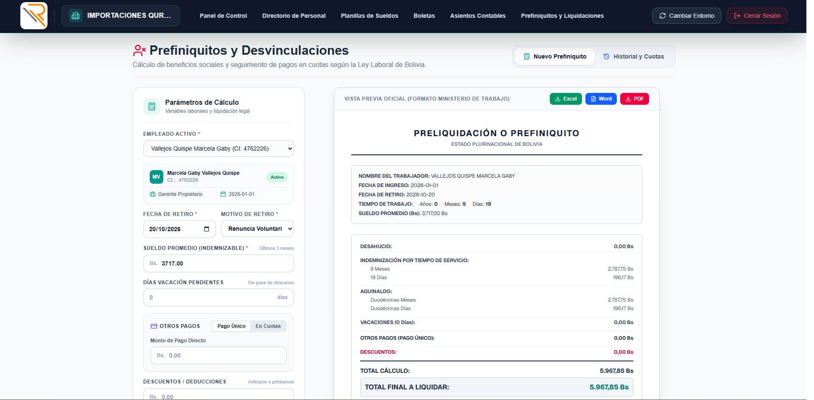

# 🏢 Sistema de Gestión de Planillas, Boletas de Pago y Contabilidad Laboral (Bolivia)

[](https://fastapi.tiangolo.com)
[](https://nextjs.org)
[](https://www.typescriptlang.org)
[](https://www.postgresql.org)
[](https://www.docker.com)
[](https://tailwindcss.com)

Sistema integral de gestión de recursos humanos, nómina salarial, aportes patronales, aguinaldos navideños, emisión de boletas de pago, prefiniquitos/finiquitos y generación automatizada de asientos contables, estrictamente ajustado a la **Ley General del Trabajo y normativas de seguridad social de Bolivia**.

---

## 📑 Tabla de Contenidos

- [🌟 ¿Qué hace el Sistema? (Módulos y Funcionalidades)](#-qué-hace-el-sistema-módulos-y-funcionalidades)
- [📸 Galería de Capturas de Pantalla](#-galería-de-capturas-de-pantalla)
- [📂 ¿Dónde guardar las capturas de pantalla?](#-dónde-guardar-las-capturas-de-pantalla)
- [🛠️ Stack Tecnológico](#️-stack-tecnológico)
- [🚀 Instalación y Puesta en Marcha](#-instalación-y-puesta-en-marcha)
  - [Opción 1: Despliegue Rápido con Docker Compose (Recomendado)](#opción-1-despliegue-rápido-con-docker-compose-recomendado)
  - [Opción 2: Instalación Manual para Entorno de Desarrollo](#opción-2-instalación-manual-para-entorno-de-desarrollo)
- [🧭 Flujo de Trabajo Recomendado](#-flujo-de-trabajo-recomendado)
- [📁 Estructura del Repositorio](#-estructura-del-repositorio)
- [⚖️ Reglas Laborales y Estándares Bolivianos Implementados](#️-reglas-laborales-y-estándares-bolivianos-implementados)

---

## 🌟 ¿Qué hace el Sistema? (Módulos y Funcionalidades)

El sistema automatiza el ciclo de vida laboral y contable completo de una o múltiples empresas en Bolivia:

### 1. 🏢 Arquitectura Multi-Tenant (Multi-Empresa Aislada)
* **Aislamiento por Esquema (`Schema-per-tenant`):** Cada empresa cuenta con su propio esquema independiente en PostgreSQL, garantizando confidencialidad y aislamiento total de datos.
* **Ficha Corporativa:** Registro de Razón Social, NIT, N° Patronal de Caja de Salud, Tipo de Caja aseguradora (Caja Petrolera de Salud, Caja Nacional de Salud, etc.), Código de Empleador ante el Ministerio de Trabajo (OVT) y logotipo institucional.

### 2. 👥 Gestión Integral de Empleados
* **Padrón Laboral Completo:** Registro de datos personales, Documento de Identidad con complemento/extensión, fecha de nacimiento, fecha de ingreso, cargo u ocupación, haber básico contractual, horas laborales y días pagados.
* **Control de Estados:** Trabajadores activos y personal retirado.
* **Desvinculación Inteligente:** El botón de desvinculación redirige al trabajador directamente al módulo de Prefiniquitos para garantizar una liquidación formal de beneficios sociales antes de marcarlo como inactivo.
* **Exportación de Nómina a Excel:** Descarga consolidada de la lista de trabajadores con fecha de ingreso y fecha de salida (para personal retirado) o celda vacía intuitiva para empleados activos, lista para inspecciones laborales.

### 3. 💵 Planilla de Sueldos y Salarios Mensual
* **Bono de Antigüedad Automático:** Cálculo dinámico según la escala laboral boliviana (Decreto Supremo 21060 / 23154) aplicada sobre la base de 3 Salarios Mínimos Nacionales (SMN).
* **Otros Ingresos y Bonificaciones:** Subsidio de frontera, bono de producción, trabajo extraordinario (horas extras), pago dominical y otros ingresos.
* **Aportes Laborales de Ley a la Gestora Pública (12.71%):**
  * Cotización Mensual (Vejez): **10.00%**
  * Prima por Riesgo Común: **1.71%**
  * Comisión Gestora: **0.50%**
  * Aporte Solidario del Asegurado: **0.50%**
* **Deducciones Fiscales e Internas:** RC-IVA (Régimen Complementario al IVA con descargo de F-110), anticipos de sueldo y descuentos varios.
* **Líquido Pagable:** Cálculo exacto en cifras numéricas y transcripción literal automática ("Son: X Bolivianos").
* **Exportación Oficial:** Generación multi-hoja por mes en formato Excel (`.xlsx`) y conversión automática a PDF con encabezados legales y descripción clara de aportes a la Gestora Pública al **12.71%**.

### 4. 🏛️ Planilla Patronal y Cargas Sociales
* **Aportes Patronales de Ley (17.21%):**
  * Seguro de Salud (Caja de Salud): **10.00%**
  * Prima de Riesgo Profesional (Gestora): **1.71%**
  * Aporte Patronal Solidario (Gestora): **3.50%**
  * Pro-Vivienda / FONVI: **2.00%**
* **Provisiones y Beneficios Sociales:**
  * Provisión para Aguinaldo: **8.33%** (1/12)
  * Previsión para Indemnización: **8.33%** (1/12)
* **Carga Patronal Total:** Consolidado de aportes más provisiones por cada empleado.
* **Diseño Oficial de Exportación:** Columnas independientes para `APELLIDOS Y NOMBRES` y `OCUPACIÓN QUE DESEMPEÑA`, totales automáticos con sumas en Excel y bloque simétrico de firmas al pie (Representante Legal, C.I. y Firma).

### 5. 🎁 Planilla de Aguinaldos de Navidad
* **Cálculo de Ley:** Promedio de los 3 últimos sueldos (Septiembre, Octubre y Noviembre).
* **Regla de Duodécimas para Desvinculados:** Si un trabajador fue desvinculado durante el año, el cálculo computa exactamente el mes de salida como trabajado (el mes de retiro cuenta completo, pero los meses posteriores ya no).
* **Boletas de Aguinaldo:** Generación de boletas individuales y plantilla general exportable a Excel y PDF.

### 6. 📄 Boletas de Pago Oficiales
* **Formato Dual Empleador / Empleado:** Boletas individuales detalladas con desglose de haberes, bonos, descuentos y retenciones.
* **Descarga Individual y Masiva (Batch):** Exportación en un solo archivo con una pestaña por empleado en Excel o compilación en PDF listo para impresión y firma.

### 7. ⚖️ Prefiniquitos y Finiquitos Laborales (Beneficios Sociales)
* **Cálculo Preciso de Derechos Adquiridos:**
  * Desahucio (3 meses de sueldo en caso de despido intempestivo).
  * Indemnización por tiempo de servicios (Años completos, meses y días calculados al día de retiro).
  * Duodécimas de Aguinaldo correspondientes a la gestión.
  * Vacaciones pendientes no gozadas según escala de antigüedad.
  * Otros pagos o derechos especiales.
* **Modalidades de Liquidación:**
  * **Pago Único:** Liquidación directa al contado.
  * **En Cuotas:** Financiamiento acordado en cuotas con abono inicial, registro de comprobantes y amortizaciones progresivas.
* **Multa del 30%:** Aplicación automática u optativa de la sanción legal por incumplimiento del plazo perentorio de 15 días calendario.
* **Historial 100% Editable:** Cualquier prefiniquito registrado puede editarse desde la pestaña de Historial, permitiendo ajustar motivos, montos, cuotas o deducciones, recalculando el finiquito y resincronizando en tiempo real la planilla de aguinaldos del trabajador.
* **Documentos Oficiales:** Generación automática del documento oficial en Microsoft Word (`.docx`) y en formato Excel/PDF.

### 8. 📊 Asientos Contables Automatizados y Libro Diario
* **Cuadrantes de Asientos Contables:**
  * **Cuadrante 1 (Devengamiento):** Sueldos y salarios por departamento (Administración, Mano de Obra, Ventas), Bono de antigüedad, Retenciones laborales por pagar y Sueldos por pagar.
  * **Cuadrante 2 (Aportes Patronales):** Cargas sociales (Gestora 7.21%, Seguro de Salud 10%) contra pasivos patronales por pagar.
  * **Cuadrante 3 (Beneficios Sociales):** Gasto por Aguinaldo e Indemnización contra Previsiones y Provisiones.
  * **Cuadrante 4 (Ministerio de Trabajo):** Obligaciones OVT con arancel mensual base (Bs. 27.00) más trámites laborales adicionales agregables dinámicamente.
* **Comprobantes de Pago / Egreso con Gestión de Saldos Diferidos:**
  * **Pago Gestora Pública:** Liquidación de retenciones (12.71%) y patronal (7.21%), con soporte para importes restantes diferidos, recargo por mora/intereses y un checklist inteligente para decidir en qué mes futuro liquidar cada saldo diferido.
  * **Pago Caja de Salud:** Liquidación del aporte de salud (10%) con importes restantes y selección de meses para regularización.
  * **Pago Ministerio de Trabajo:** Registro del arancel y trámites cancelados.
* **Exportación Contable:** Generación del Comprobante de Diario en Excel y PDF con balance cuadrado garantizado ($\sum \text{Debe} = \sum \text{Haber}$).

### 9. 🎯 Estandarización Numérica y Redondeo Exacto a 2 Decimales
* **Cálculos Internos:** Precisión matemática extendida (hasta 4 decimales) para coeficientes y tasas fraccionarias.
* **Visualización y Reportes:** Estandarización estricta de todos los montos a **2 decimales exactos (`#,##0.00` / `Bs. 92.12`)** tanto en las tablas del sistema web como en las exportaciones oficiales.

---

## 📸 Galería de Capturas de Pantalla

A continuación se muestra la vista previa de las interfaces principales del sistema.

### 1. Panel de Control y Métricas Generales

*Resumen ejecutivo con indicadores de nómina, total ganado, aportes y estado de los empleados activos.*

---

### 2. Selector y Configuración de Empresas Multi-Tenant

*Gestión de razones sociales independientes, asignación de NIT, número patronal, caja de salud y logos corporativos.*

---

### 3. Padrón y Gestión de Empleados

*Administración de personal, sueldos contractuales, fechas de ingreso/retiro y exportación a Excel.*

---

### 4. Planilla Mensual de Sueldos y Salarios

*Cálculo de haberes, bono de antigüedad automático, aportes laborales a la Gestora Pública (12.71%) y líquido pagable.*

---

### 5. Planilla Patronal y Cargas Sociales

*Desglose de aportes patronales (17.21%), provisiones de aguinaldo e indemnización, con columnas separadas de nombres y cargos.*

---

### 6. Planilla de Aguinaldos de Navidad

*Cálculo sobre el promedio trimestral de ley, duodécimas sincronizadas con desvinculaciones y generación de boletas navideñas.*

---

### 7. Emisión Oficial de Boletas de Pago

*Boletas de pago oficiales en formato dual empleador/trabajador listas para exportar a Excel y PDF.*

---

### 8. Asientos Contables y Comprobantes de Pago

*Cuadrantes de devengamiento, cargas sociales, beneficios y comprobantes de egreso con gestión de importes restantes.*

---

### 9. Prefiniquitos y Liquidación de Beneficios Sociales

*Cálculo legal de indemnización, desahucio, vacaciones no gozadas, pagos en cuotas e historial 100% editable.*

---

## 📂 ¿Dónde guardar las capturas de pantalla?

Para que las imágenes anteriores se vean directamente en GitHub, en tu lector de Markdown o en la documentación:

1. Ubica la carpeta creada en la raíz del proyecto:
   ```text
   sistema_de_boletas_de_pago-RengifoLtda/
   └── docs/
       └── screenshots/   <--- [Guarda aquí tus capturas]
   ```
2. Guarda tus capturas de pantalla con los siguientes nombres exactos:

| Archivo requerido | Pantalla recomendada |
| :--- | :--- |
| `dashboard.png` | Captura del Inicio / Dashboard (`http://localhost:3000/inicio`) |
| `empresas.png` | Captura del Selector de Empresas (`http://localhost:3000/seleccionar-empresa`) |
| `empleados.png` | Captura del Módulo de Empleados (`http://localhost:3000/empleados`) |
| `planillas_sueldos.png` | Captura de la Planilla de Sueldos (`http://localhost:3000/planillas`) |
| `planillas_patronal.png` | Captura de la Planilla Patronal (`http://localhost:3000/planillas` - Pestaña Patronal) |
| `planillas_aguinaldos.png` | Captura de la Planilla de Aguinaldos (`http://localhost:3000/planillas` - Pestaña Aguinaldos) |
| `boletas_pago.png` | Captura del Módulo de Boletas (`http://localhost:3000/boletas`) |
| `asientos_contables.png` | Captura de Asientos Contables (`http://localhost:3000/asientos`) |
| `prefiniquitos.png` | Captura de Prefiniquitos (`http://localhost:3000/prefiniquitos`) |

> [!TIP]
> Puedes utilizar formato `.png` o `.jpg` con resolución recomendada de **1920x1080** para una visualización óptima y profesional.

---

## 🛠️ Stack Tecnológico

| Capa | Tecnologías | Propósito |
| :--- | :--- | :--- |
| **Frontend** | Next.js 16 (App Router), React 19, TypeScript, Tailwind CSS, Lucide React, Framer Motion | Interfaz moderna, reactiva, accesible y de alto rendimiento visual. |
| **Backend API** | FastAPI, Python 3.12, Uvicorn, Pydantic v2 | API RESTful asíncrona, validación tipada y reglas laborales. |
| **Base de Datos** | PostgreSQL 15, SQLAlchemy ORM | Base relacional con soporte Multi-Tenant por esquemas dinámicos. |
| **Documentos** | OpenPyXL, python-docx, docxtpl, LibreOffice (Headless) | Generación precisa de planillas en Excel, finiquitos en Word y conversión a PDF. |
| **DevOps & Contenedores** | Docker, Docker Compose, Alpine Linux | Despliegue reproducible con 1 comando para base de datos, backend y frontend. |

---

## 🚀 Instalación y Puesta en Marcha

### Opción 1: Despliegue Rápido con Docker Compose (Recomendado)

Esta opción levanta automáticamente **la base de datos PostgreSQL**, el **administrador pgAdmin**, el **Backend con LibreOffice** y el **Frontend de Next.js** sin necesidad de instalar dependencias locales adicionales.

#### 1. Requisitos Previos:
* [Docker Desktop](https://www.docker.com/products/docker-desktop/) instalado y en ejecución en Windows, Linux o macOS.

#### 2. Clonar y Levantar los Servicios:
Abre una terminal en la carpeta raíz del proyecto y ejecuta:

```bash
# 1. Clonar el repositorio (si aún no lo has hecho)
git clone https://github.com/tu-usuario/sistema_de_boletas_de_pago-RengifoLtda.git
cd sistema_de_boletas_de_pago-RengifoLtda

# 2. Levantar todos los contenedores en segundo plano
docker compose up -d --build
```

#### 3. URLs de Acceso y Servicios:

| Servicio | URL Local | Credenciales por Defecto |
| :--- | :--- | :--- |
| **Frontend Web** | [http://localhost:3000](http://localhost:3000) | Acceso directo al sistema |
| **Backend API & Swagger** | [http://localhost:8000/docs](http://localhost:8000/docs) | Documentación interactiva de la API |
| **pgAdmin 4 (Gestor DB)** | [http://localhost:5050](http://localhost:5050) | **User:** `admin@rengifo.com`<br>**Password:** `rengifo_planillaspago-826` |
| **PostgreSQL Port** | `localhost:5454` | **User:** `admin_rengifo`<br>**DB:** `db_planillas_pago_rengifo` |

#### Comandos Útiles de Docker:
```bash
# Ver estado de los contenedores
docker compose ps

# Ver logs del backend en tiempo real
docker compose logs -f backend

# Reiniciar servicios
docker compose restart

# Detener los servicios
docker compose down
```

---

### Opción 2: Instalación Manual para Entorno de Desarrollo

Si prefieres ejecutar los componentes de forma nativa en tu máquina local:

#### 1. Requisitos Previos:
* **Node.js** v18 o superior y **npm**.
* **Python** v3.12 o superior.
* **PostgreSQL** v15 en ejecución local.
* **LibreOffice** (opcional, requerido únicamente si deseas convertir Excel/Word a PDF localmente sin Docker).

#### 2. Configurar la Base de Datos:
Crea una base de datos en tu servidor PostgreSQL local (por ejemplo `db_planillas_pago_rengifo`).

#### 3. Configurar y Levantar el Backend (FastAPI):
```bash
# Entrar a la carpeta del backend
cd backend

# Crear y activar entorno virtual
python -m venv venv

# En Windows:
venv\Scripts\activate
# En Linux/macOS:
# source venv/bin/activate

# Instalar dependencias
pip install -r requirements.txt

# Configurar variables de entorno (crear archivo .env en backend/)
# POSTGRES_SERVER=localhost
# POSTGRES_PORT=5432
# POSTGRES_USER=postgres
# POSTGRES_PASSWORD=tu_password
# POSTGRES_DB=db_planillas_pago_rengifo

# Iniciar servidor FastAPI
uvicorn main:app --reload --port 8000
```
*API disponible en:* `http://localhost:8000`

#### 4. Configurar y Levantar el Frontend (Next.js):
En una nueva terminal:
```bash
# Entrar a la carpeta frontend
cd frontend

# Instalar paquetes de npm
npm install

# Iniciar en modo desarrollo
npm run dev
```
*Aplicación disponible en:* `http://localhost:3000`

---

## 🧭 Flujo de Trabajo Recomendado

1. **Paso 1 - Selección o Alta de Empresa:**  
   Ingresa a [http://localhost:3000](http://localhost:3000). Serás dirigido al selector de empresas. Selecciona una empresa existente o crea una nueva definiendo su NIT, N° Patronal y entidad de salud.
2. **Paso 2 - Registro de Empleados:**  
   Ingresa al módulo **Empleados** para registrar a los trabajadores con su cédula de identidad, haber básico contractual, fecha de ingreso y cargo.
3. **Paso 3 - Elaboración de Planillas:**  
   En el módulo **Planillas**, selecciona el mes y año. El sistema calculará automáticamente la Planilla de Sueldos y la Planilla Patronal. Podrás exportar ambos documentos oficiales en Excel o PDF.
4. **Paso 4 - Emisión de Boletas:**  
   Accede a **Boletas** para consultar o descargar las papeletas de pago con firma dual en formato oficial.
5. **Paso 5 - Generación de Asientos Contables:**  
   Dirígete a **Asientos Contables**. El sistema pre-calculará los cuadrantes de devengamiento, aportes patronales y beneficios sociales. Registra los comprobantes de pago de la Gestora, Caja y Mintrabajo, y exporta el libro diario contable.
6. **Paso 6 - Prefiniquitos y Desvinculaciones:**  
   Cuando un trabajador concluya su relación laboral, utiliza el botón de desvinculación desde Empleados o genera su liquidación en **Prefiniquitos**, calculando quinquenio, desahucio, vacaciones y emitiendo el finiquito oficial en Word o Excel.

---

## 📁 Estructura del Repositorio

```text
sistema_de_boletas_de_pago-RengifoLtda/
│
├── docker-compose.yml              # Orquestación de contenedores (DB, pgAdmin, Backend, Frontend)
├── README.md                       # Documentación principal del sistema
│
├── docs/                           # Documentación y recursos gráficos
│   └── screenshots/                # Capturas de pantalla para el README
│       ├── dashboard.png
│       ├── empleados.png
│       ├── planillas_sueldos.png
│       ├── planillas_patronal.png
│       ├── planillas_aguinaldos.png
│       ├── boletas_pago.png
│       ├── asientos_contables.png
│       └── prefiniquitos.png
│
├── backend/                        # API RESTful en FastAPI (Python 3.12)
│   ├── Dockerfile                  # Imagen Docker del Backend con LibreOffice
│   ├── requirements.txt            # Dependencias de Python
│   ├── main.py                     # Punto de entrada de la aplicación FastAPI
│   └── app/
│       ├── api/                    # Endpoints REST (payrolls, patronal, aguinaldos, prefiniquitos, etc.)
│       ├── db/                     # Conexión SQLAlchemy y gestión multi-tenant por esquemas
│       ├── models/                 # Modelos ORM de Base de Datos
│       ├── schemas/                # Esquemas y validadores Pydantic v2
│       ├── services/               # Lógica de cálculo laboral, contable y exportación documental
│       └── templates/              # Plantillas base oficiales (.xlsx y .docx)
│
└── frontend/                       # Aplicación Web en Next.js 16 (React 19)
    ├── package.json                # Dependencias y scripts
    ├── tsconfig.json               # Configuración de TypeScript
    ├── tailwind.config.js          # Configuración de estilos y diseño
    └── src/
        └── app/
            ├── (panel)/            # Vistas protegidas de la aplicación
            │   ├── inicio/         # Dashboard principal y métricas
            │   ├── empleados/      # Padrón de trabajadores y exportación
            │   ├── planillas/      # Planillas de Sueldos, Patronal y Aguinaldos
            │   ├── boletas/        # Papeletas y boletas de pago
            │   ├── asientos/       # Asientos contables y comprobantes de egreso
            │   └── prefiniquitos/  # Beneficios sociales y finiquitos
            └── seleccionar-empresa/ # Selector y creador de empresas Multi-Tenant
```

---

## ⚖️ Reglas Laborales y Estándares Bolivianos Implementados

* **Bono de Antigüedad (D.S. 21060 / 23154):**
  * 0 a 1 año: `0%`
  * 2 a 4 años: `5%`
  * 5 a 7 años: `11%`
  * 8 a 10 años: `18%`
  * 11 a 14 años: `26%`
  * 15 a 19 años: `34%`
  * 20 a 24 años: `42%`
  * 25 o más años: `50%`  
  *(Calculado sobre la base legal de tres salarios mínimos nacionales).*
* **Gestora Pública de la Seguridad Social de Largo Plazo:** Retención laboral exacta del **12.71%**.
* **Aportes Patronales:** Total legal del **17.21%** (10% Salud + 1.71% Riesgo Profesional + 2% Vivienda + 3.5% Solidario).
* **Beneficios Sociales:** Provisión de 1 duodécima mensual (**8.33%**) para Aguinaldo y **8.33%** para Indemnización.
* **Liquidación de Finiquito:** Cómputo por quinquenio o duodécimas exactas (años, meses y días), con aplicación de la multa del **30%** en caso de sobrepasar los 15 días posteriores al retiro.

---

*Desarrollado para la gestión empresarial, laboral y contable en el Estado Plurinacional de Bolivia.*
